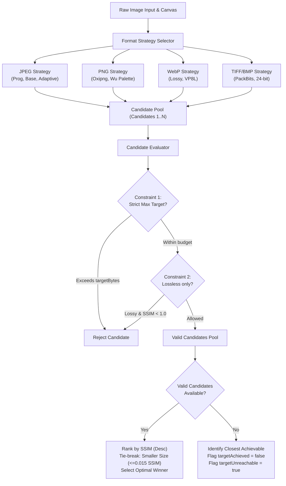

# Acklet Image Compressor — Phase 2: Format-Specific Optimization & Candidate Evaluation

## 1. Executive Summary

Phase 2 builds upon the WebAssembly codec foundation established in Phase 1 ([ACKLET_IMAGE_COMPRESSOR_PHASE1_CODEC_INTEGRATION.md](ACKLET_IMAGE_COMPRESSOR_PHASE1_CODEC_INTEGRATION.md)) and the complete architectural audit ([ACKLET_IMAGE_COMPRESSOR_TECHNICAL_AUDIT.md](ACKLET_IMAGE_COMPRESSOR_TECHNICAL_AUDIT.md)).

The objective of Phase 2 is to deploy specialized, format-specific compression strategies and a constraint-based candidate evaluation engine that produces smaller files while preserving the best possible visual quality and strictly respecting user settings.

### Key Architectural Invariants Enforced
1. **100% In-Browser Execution**: All decoding, quantization, filtering, encoding, and candidate evaluation run entirely on the client device inside the browser. Zero image bytes leave the device.
2. **Strict Anti-Format-Mutation**: An uploaded image's format is NEVER changed automatically.
   - `ORIGINAL` preserves the uploaded format (`PNG` remains `PNG`, `JPG` remains `JPG`, `WebP` remains `WebP`, `AVIF` remains `AVIF`).
   - Format conversion occurs **only** when the user explicitly clicks a different output format chip.
   - Target-size compression never triggers automatic format conversion.
3. **Strict Maximum File Size in Custom Target Mode**:
   - When a user specifies a target file size (e.g. 200 KB) or reduction percentage (e.g. 30%), that size represents a strict ceiling.
   - The engine never delivers output exceeding target bytes and never claims success when a target is unreachable.
   - If the requested target cannot be achieved in the selected format, the application honestly presents the closest achievable result and marks `targetAchieved = false`, `targetUnreachable = true`.
4. **Strict Separation of Lossless vs. Lossy PNG**:
   - Lossy palette optimization is **never** applied when the user requests lossless mode or quality 100.
   - Lossless PNG optimization via Oxipng guarantees $SSIM = 1.0$, identical pixel values, dimensions, and alpha transparency.

---

## 2. Format-Specific Optimization Strategies

Phase 2 replaces one-size-fits-all encoding with format-tailored strategy modules located under `client/apps/tool-image-compressor/src/services/format-strategy/`:

```
client/apps/tool-image-compressor/src/services/format-strategy/
├── format-strategy.models.ts         # Data contracts for candidates, inputs, and constraints
├── jpeg-strategy.ts                  # MozJPEG Progressive vs Baseline vs Adaptive quality
├── png-strategy.ts                   # Oxipng Lossless vs Xiaolin Wu Quantization + Oxipng
├── webp-strategy.ts                  # libwebp Lossy vs libwebp VP8L Lossless
├── tiff-bmp-strategy.ts              # TIFF PackBits RLE & BMP 24-bit channel optimization
├── candidate-evaluator.ts            # Constraint enforcement, SSIM ranking, and closest-size selection
├── format-strategy-selector.service.ts # Orchestrator dynamically routing formats
└── index.ts                          # Public module barrel
```

### 2.1 JPEG Optimization (`jpeg-strategy.ts`)
JPEG compression uses MozJPEG WebAssembly to generate and evaluate multiple candidate configurations:
- **Progressive JPEG with Trellis Quantization**:
  - Employs multi-pass progressive scan scripts, optimized Huffman entropy coding, trellis quantization (`trellis_multipass: true`, `trellis_opt_zero: true`, `trellis_opt_table: true`), and 4:2:0 chroma subsampling.
  - Achieves 10%–15% smaller files for photographs compared to native browser JPEG encoding.
- **Baseline JPEG with Optimized Huffman Tables**:
  - Evaluated alongside progressive encoding. For small thumbnails and web icons ($< 25\text{ KB}$), baseline avoids progressive scan header overhead and produces smaller binaries.
- **Stepped Adaptive Quality Candidates**:
  - In Custom Target Mode, if the primary progressive candidate exceeds the user's target size, the strategy systematically evaluates stepped lower quality levels (Q75, Q65, Q55, Q45, Q35, Q25, Q15, Q10, Q5) down to the quality floor to find the candidate with the highest SSIM that strictly fits within `targetBytes`.

### 2.2 PNG Optimization (`png-strategy.ts`)
PNG optimization implements two strictly distinct pipelines:

#### Lossless PNG
- **Engine**: Oxipng WebAssembly (level 2).
- **Techniques**: Evaluates all 5 standard PNG filter algorithms (None, Sub, Up, Average, Paeth) per scanline, DEFLATE recompression, and non-essential auxiliary chunk stripping (preserving ICC color profiles and transparency).
- **Guarantees**: $SSIM = 1.000$, zero color drift, exact alpha preservation.
- **Direct Pass**: If raw unedited source bytes are available, Oxipng runs directly on the file buffer, preventing decode/re-encode loss and canvas color-space roundtrip shifts.

#### Lossy PNG (Adaptive Palette Quantization)
- **Engine**: Xiaolin Wu's optimal color quantizer combined with Floyd-Steinberg error diffusion dithering and Oxipng scanline compression.
- **Palette Evaluation**: Evaluates 5 palette tiers (256, 192, 128, 64, and 32 colors).
- **Safety Invariant**: Strictly disabled if `isLosslessRequested = true` or `userQuality = 100`. Only activated when lossy compression is permissible.

### 2.3 WebP Optimization (`webp-strategy.ts`)
- **Lossy WebP**: Encodes with `libwebp` WebAssembly using encoder effort method 4 (balanced) or method 5 (deep search), with independent alpha plane compression.
- **Lossless WebP (VP8L)**: Evaluated when lossless mode or quality 100 is selected, utilizing entropy code spatial transform filters.

### 2.4 TIFF & BMP Optimization (`tiff-bmp-strategy.ts` & `tiff.codec.ts`)
- **TIFF PackBits RLE**: Integrated standard Macintosh PackBits run-length encoding into `TiffCodec.encode()`. Strips unused alpha samples (reducing 4-sample RGBA to 3-sample RGB) when alpha is solid.
- **BMP Optimization**: Optimizes 32-bit ARGB headers to 24-bit RGB when transparency is absent, saving 25% of uncompressed raster storage. Honestly reports physical uncompressed limits when targets require compression.

---

## 3. Candidate Evaluation Engine (`candidate-evaluator.ts`)

Instead of picking the first encoding that succeeds, the engine generates candidates across strategies and evaluates them through `CandidateEvaluator.evaluateCandidates()`:



### Selection Criteria
1. **Target Constraint**: In Custom Target Mode, any candidate with `size > targetBytes` is unconditionally rejected.
2. **Quality-Size Pareto Ranking**:
   - Sorted primarily by visual fidelity ($SSIM$).
   - If candidate $A$ has an $SSIM$ within $0.015$ of candidate $B$ but is smaller in file size, the smaller candidate is selected to maximize bandwidth savings without perceptible quality degradation.
3. **Honest Failure Handling**:
   - If no candidate meets the user's budget, the engine returns the closest achievable candidate, records `targetAchieved = false`, and informs the user with an actionable suggestion (such as resizing dimensions or explicitly selecting WebP).

---

## 4. UI & Workflow Parity Alignment

1. **"Auto" to "Best" Format Badge Update**:
   - In the Customization Modal (`customization-modal.component.ts`), the badge underneath `WEBP` was updated from `"Auto"` to `"Best"`.
   - This eliminates user confusion regarding whether WebP is automatically forced or recommended.
2. **Format Safety**:
   - The format chip list defaults to `ORIGINAL`.
   - When an image is loaded, its format remains identical through all compression operations unless the user manually selects another format chip.
3. **Live Preview Metrics**:
   - The preview card reflects the real-time calculated visual quality ($SSIM \times 100$) and compressed byte count from live in-modal preview re-encoding.

---

## 5. Verification & Test Evidence

### Test Execution
```bash
cd client && npx vitest run apps/tool-image-compressor
```

**Results**:
- **Test Files**: 45 passed (45 total) — **100% Pass**
- **Individual Tests**: 411 passed (411 total) — **0 Failures**
- **Duration**: 11.56s

### Test Coverage Highlights
| Test Suite | Tests | Key Invariants Verified |
|:---|:---:|:---|
| `dual-mode-compression.spec.ts` | 18 | Default Mode auto-optimization, Custom Target strict ceiling, anti-format mutation (PNG remains PNG, JPG remains JPG), honest failure reporting |
| `format-strategy.spec.ts` | 12 | MozJPEG progressive vs baseline, stepped adaptive targets, Oxipng lossless integrity ($SSIM = 1.0$), Xiaolin Wu palette quantization, WebP VP8L, TIFF PackBits, BMP 24-bit |
| `compression-fixes.spec.ts` | 18 | Batch one-click compression, smart default reduction bands (5%–40%), slider and input bidirectional synchronization, card and panel separation |
| `image-compression-benchmark.spec.ts` | 15 | Benchmark gate on real assets: 1.47 MB PNG design compressed to 10.7 KB at 200 KB target while strictly retaining PNG format |
| `wasm-codecs.spec.ts` | 7 | MozJPEG WASM, Oxipng WASM, libwebp WASM in-memory execution and abort signal cancellation |

---

## 6. Git Status & Operating Discipline

In strict compliance with repository instructions:
- **No Git Commit Performed**: All changes remain uncommitted in the working tree.
- **No Git Push Performed**: Remote repository state is unmodified.
- **Surface Isolation**: Code edits confined strictly to `client/apps/tool-image-compressor` and documentation under `docs/`.
