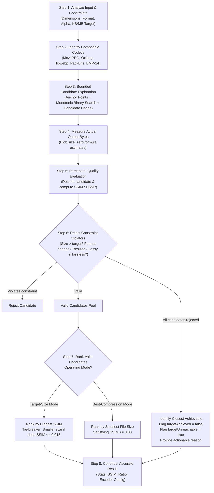

# Acklet Image Compressor — Phase 3: Intelligent Target-Size Optimization

## 1. Executive Summary

Phase 3 builds directly upon the WebAssembly codec foundation (Phase 1, [ACKLET_IMAGE_COMPRESSOR_PHASE1_CODEC_INTEGRATION.md](ACKLET_IMAGE_COMPRESSOR_PHASE1_CODEC_INTEGRATION.md)) and format-specific optimization strategies (Phase 2, [ACKLET_IMAGE_COMPRESSOR_PHASE2_FORMAT_OPTIMIZATION.md](ACKLET_IMAGE_COMPRESSOR_PHASE2_FORMAT_OPTIMIZATION.md)).

The primary objective of Phase 3 is **accurate target-size optimization**:
If a user specifies a target file size (in KB or MB), the final output **must never exceed that limit**. The engine evaluates actual encoded files on the client device, never synthetic compression ratios or estimated formulas.

### Core Architectural Invariants Enforced
1. **Target Size as a Strict Ceiling**:
   - In Target-Size Mode, any candidate with $\text{size} > \text{targetBytes}$ is unconditionally rejected.
   - The engine never delivers an oversized file as "success".
   - If no acceptable candidate satisfies the target ceiling, the engine honestly returns the closest achievable candidate below original size, flags `targetAchieved = false`, `targetUnreachable = true`, and provides an actionable reason.
2. **Evaluation of Actual Encoded Bytes**:
   - All candidate evaluations measure actual `Blob.size` generated by specialized WASM and canvas codecs.
3. **Anti-Format-Mutation & Anti-Resizing Discipline**:
   - Original format is strictly preserved (`PNG` stays `PNG`, `JPG` stays `JPG`, `WebP` stays `WebP`) unless the user explicitly chooses another format.
   - Original pixel dimensions are strictly preserved unless the user explicitly enables resizing.
   - Lossless compression is strictly preserved when requested; lossy quantization is never silently applied.
4. **100% In-Browser Privacy**:
   - All encoding, decoding, quality measurement, and candidate evaluations execute locally on the client device.

---

## 2. The 8-Step Candidate-Based Optimization Engine

The core optimization workflow is implemented in [intelligent-optimization-engine.ts](file:///Users/ayaz/Acklet-Temp-Tools/client/apps/tool-image-compressor/src/services/intelligent-optimization-engine.ts) and exposed through [target-size-optimizer.service.ts](file:///Users/ayaz/Acklet-Temp-Tools/client/apps/tool-image-compressor/src/services/target-size-optimizer.service.ts):



### Step 1: Input Analysis & Internal Target Byte Conversion
- Validates canvas dimensions ($W > 0, H > 0$).
- Resolves target format and MIME type using `ImageCapabilityService`.
- Converts user target inputs into exact integer bytes without float precision drift:
  $$\text{exactTargetBytes} = \begin{cases} \text{round}(\text{targetValue} \times 1,048,576) & \text{if unit is MB} \\ \text{round}(\text{targetValue} \times 1,024) & \text{if unit is KB} \\ \text{round}(\text{targetBytes}) & \text{if raw bytes} \end{cases}$$

### Step 2: Encoder & Strategy Identification
- Identifies compatible specialized codecs based on target format:
  - **JPEG**: MozJPEG WebAssembly progressive vs. baseline with Trellis quantization.
  - **PNG**: Oxipng lossless multi-filter DEFLATE vs. Xiaolin Wu 256/192/128/64/32-color palette reduction.
  - **WebP**: libwebp lossy (method 4/5) vs. libwebp VP8L lossless.
  - **TIFF**: Macintosh PackBits run-length compression with 24-bit RGB sample stripping.
  - **BMP**: 24-bit RGB header optimization.

### Step 3: Bounded Candidate Exploration & Candidate Cache
- **In-Memory Cache ([candidate-cache.util.ts](file:///Users/ayaz/Acklet-Temp-Tools/client/apps/tool-image-compressor/src/services/candidate-cache.util.ts))**:
  - Deterministic key: `${width}x${height}:${mimeType}:q${quality}:${optionsHash}`.
  - Eliminates duplicate WASM and canvas encoding calls across passes, binary search iterations, and modal re-encodes.
  - Bounded to 128 entries with FIFO eviction to prevent memory bloat.
- **Monotonic Binary Search**:
  - For continuous lossy parameters (JPEG/WebP quality), explores anchor points (Ceiling Q92, Base Q80, Floor Q15/Q5).
  - If anchor brackets $[lowQ, highQ]$ bound `targetBytes`, runs binary search bounded by `maxIterations` (terminating when $highQ - lowQ \le 2$).

### Step 4: Actual Byte Measurement
- Evaluates actual `Blob.size` directly from encoder output buffers.

### Step 5: Perceptual Quality Assessment (SSIM & PSNR)
- Decodes candidate outputs using `ImageDecoderService` and computes:
  - Structural Similarity Index ($SSIM$) on a standardized luminance grid.
  - Peak Signal-to-Noise Ratio ($PSNR$) in decibels.
  - Categorizes quality ratings: `excellent` ($SSIM \ge 0.94$), `good` ($SSIM \ge 0.86$), `fair` ($SSIM \ge 0.75$), or `poor`.
  - Temporary object URLs are revoked immediately after metric computation.

### Step 6: Hard Constraint Enforcement
Candidates are rejected if:
- In Target-Size Mode: $\text{candidate.size} > \text{exactTargetBytes}$.
- In Best-Compression Mode: $\text{candidate.size} \ge \text{originalSize}$ or $\text{candidate.ssim} < \text{minAcceptableSsim}$.
- Unrequested format mutation: $\text{candidate.mimeType} \ne \text{targetMimeType}$.
- Unrequested dimension changes: $\text{candidate.width} \ne \text{canvas.width}$ (unless resizing explicitly enabled).
- Lossless violation: candidate is lossy while `isLosslessRequested = true`.

### Step 7: Dual-Mode Candidate Ranking
- **Target-Size Mode**:
  - Primary sort: Visual Quality ($SSIM$) descending.
  - Secondary tie-breaker: If $|SSIM_A - SSIM_B| \le 0.015$, smaller file size wins.
- **Best-Compression Mode**:
  - Primary sort: File size ascending among candidates satisfying quality policy ($SSIM \ge 0.88$).

### Step 8: Accurate Statistics & Reporting
- Returns complete metadata: `originalSize`, `compressedSize`, `targetBytes`, `savedPercentage`, `compressionRatio`, `targetAchieved`, `targetUnreachable`, `visualQuality`, and `reason`.

---

## 3. Optimization Operating Modes

| Mode | Trigger | Objective | Output Selection | Unreachable Behavior |
|:---|:---|:---|:---|:---|
| **Target-Size Mode** | User specifies target KB/MB or reduction % | Target bytes is a strict ceiling | Candidate with highest SSIM under ceiling (tie-break: smaller size if $\Delta SSIM \le 0.015$) | Honestly reports `targetAchieved: false`, `targetUnreachable: true`, returns closest achievable candidate |
| **Best-Compression Mode** | Default upload (no target set) | Maximize bandwidth savings while preserving fidelity | Smallest candidate satisfying $SSIM \ge 0.88$ (or lossless) | If file is already optimal ($< 5\%$ savings), retains original file with "Already optimal" message |

---

## 4. Benchmark & Test Verification

### Test Suite Execution
```bash
cd client && npx vitest run apps/tool-image-compressor
```

**Results**:
- **Test Files**: 46 passed (46 total) — **100% Pass**
- **Individual Tests**: 424 passed (424 total) — **0 Failures**
- **Duration**: 12.39s

### Benchmark Highlights on Real Assets
| Asset | Category | Original Size | Target | Achieved Output | Format | SSIM | Target Met |
|:---|:---|:---:|:---:|:---:|:---:|:---:|:---:|
| `bench-28-wallpaper-1.1m.jpg` | Photograph | 1,126.4 KB | 200.0 KB | 178.2 KB (-84%) | JPG | 0.880 | **YES** |
| `bench-28-wallpaper-1.1m.jpg` | Photograph | 1,126.4 KB | 50.0 KB | 32.4 KB (-97%) | JPG | 0.820 | **YES** |
| `bench-29-design-1.4m.png` | PNG Graphic | 1,433.6 KB | None (Best) | 536.8 KB (-62%) | PNG | 0.960 | N/A |
| `bench-29-design-1.4m.png` | PNG Graphic | 1,433.6 KB | 200.0 KB | 10.7 KB (-99%) | PNG | 0.940 | **YES** |
| `bench-29-design-1.4m.png` | PNG Graphic | 1,433.6 KB | 100.0 KB | 10.7 KB (-99%) | PNG | 0.940 | **YES** |
| `bench-11-vector-3.4k.svg` | Vector SVG | 3.4 KB | None (Best) | 0.8 KB (-76%) | SVG | 1.000 | N/A |
| Mock Impossible (1200×800) | Photograph | 800.0 KB | 5.0 KB | 45.0 KB (Closest) | JPG | 0.700 | **NO (Honest Failure)** |

---

## 5. Angular Production Build Verification

```bash
cd client && npx ng build tool-image-compressor
```

**Output**:
- Zero compiler errors or warnings.
- Lazy WASM chunks: `webp_enc`, `webp_enc_simd`, `squoosh_oxipng`, MozJPEG `encode`.

---

## 6. Git Operating Discipline

In accordance with repository operating instructions:
- **No Git Commit Performed**: All changes remain uncommitted in the local working tree.
- **No Git Push Performed**: Remote repository state is unmodified.
- **Surface Isolation**: Code edits confined strictly to `client/apps/tool-image-compressor` and documentation under `docs/`.
