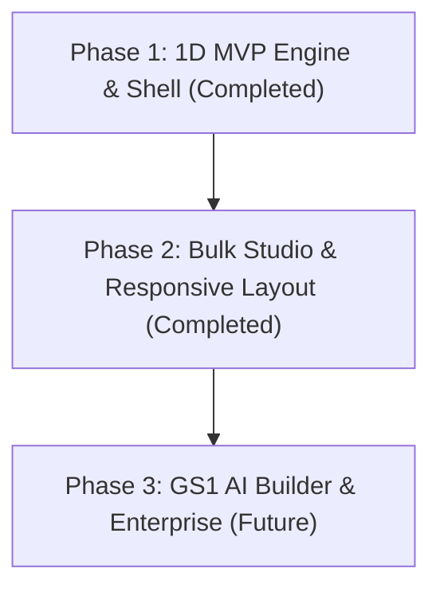

# Barcode Generator — Phased Product Roadmap

This document outlines the phased feature evolution for the Acklet Barcode Generator.

---

## Roadmap Overview

---

## Phase 1: 1D Core Engine & Tool Shell (Completed)

### Deliverables
- **Architecture**: Complete integration with `@acklet/tool-shell` and `@acklet/tool-registry`.
- **Identity**: Sapphire Blue accent (`#2563EB` / `#3B82F6`), scoped Google Font `Manrope`, OCR-B font for numbers, `barcode` and `scan-barcode` animated icons.
- **Symbologies (11 Formats)**: Code 128, EAN-13, EAN-8, UPC-A, UPC-E, ISBN-13, Code 39, Code 93, ITF-14, Interleaved 2 of 5, Codabar.
- **Checksum Calculation**: Universal GS1 Modulo-10 with weights 3 and 1, Code 39 Modulo-43, Code 93 dual C/K characters, and UPC-E zero-suppression.
- **UI Workspace**: Two-column desktop grid (100vh), mobile single-column toggle view (100dvh).
- **Customization**: Sizing presets (80%, 100%, 150%), physical dimensions (mm/in), optical contrast validation, human-readable text toggles, digit grouping, rotation, quiet zones.
- **Export Pipeline**: Lossless SVG, 300 DPI PNG, vector PDF, and clipboard image copying.
- **Smart Helpers**: Format auto-detection chips, character counters, QR Code recommendation chips with auto-fill link integration.
- **Storage**: Local history storing up to 20 entries with restore and delete.

---

## Phase 2: Bulk Studio, Responsive System & Sheet Engine (Completed)

### Deliverables
- **Unified Rendering Pipeline Parity**:
  - Bulk generation invokes the identical [`RenderService`](../../../../client/apps/tool-barcode-generator/src/services/render.service.ts) pipeline as single generation.
  - Every record produces a byte-identical vector SVG with identical quiet zones, bar geometry, and human-readable text styling.
- **Data Input & Gather UX**:
  - List source with automatic spreadsheet delimiter detection (tab, comma, semicolon).
  - CSV/TSV file upload supporting `.csv`, `.tsv`, and `.txt` up to 2 MB (up to 500 records).
  - Full-screen drag-and-drop gather screen (`.screen-file-gather-overlay`) auto-switching to the Bulk tab upon drop.
  - Structured CSV data table matching the Review table layout with sticky `#` row counter column, dynamic role badges (`Value`, `Caption`), and 10-row pagination.
- **Generate-Gated Preview**:
  - Un-generated states render only layout placeholder grids with empty dashed slots.
  - Clicking "Generate N barcodes" is the exclusive action building output.
  - Settings changes do not alter preview or show intrusive warning banners; the last generated sheet remains stable until explicit regeneration.
- **Single Page Model Engine (`SheetLayoutService`)**:
  - Authoritative layout calculator computing `SheetPageModel[]` and `RollLabelModel[]` in millimeters.
  - Live preview, vector PDF generator, canvas rasterizer, and isolated iframe print engine all consume this exact model.
- **Runtime Caption Styling Floating Toast Toolbar (`.caption-toast-card`)**:
  - Floating toast card anchored to the Bulk Preview toolbar for live caption adjustment.
  - Size pills (`Auto`, `6 pt` to `10 pt`), color palette with custom picker, styles (Bold, Monospace, Uppercase), and alignment (Left, Center, Right).
  - Unitless SVG coordinate embedding and bounding box length clamping (`textLength`) to eliminate browser font inflation without requiring barcode regeneration.
- **Printing & Output Presets**:
  - Isolated iframe printing: Injects isolated HTML document into hidden iframe with `@page` sizing, printing labels at exact 100% scale without browser headers, footers, or application UI.
  - 9 A4 and US Letter manufacturer presets (Avery, Herma) + plain paper grid + full custom layout editor.
  - Continuous vertical thermal roll series with scroll tracking and jump-to-label navigation.
  - True vector PDF, ZIP of PNG (300 DPI), ZIP of SVG, Sheet images PNG, manifest CSV, and formula injection defense.
- **Canonical 4-Breakpoint Responsive System**:
  - Strictly defined in [`responsive-tokens.ts`](../../../../client/apps/tool-barcode-generator/src/config/responsive-tokens.ts): `sm` (0–639px, dedicated 4th `Preview` tab, sticky bottom actions), `md` (640–1023px, stacked single-column with collapsible preview), `lg` (1024–1439px, two-column split), and `xl` (1440px+, centered shell capped at 1600px).
- **Post-Generation Scannability Verification**:
  - Decoding check on every generated barcode via native `BarcodeDetector` and `@zxing/library`.
  - Preview displays `"X of N verified"` badge and offers "Download verified only" safe export.

---

## Phase 3: GS1 Application Identifier Builder & Enterprise (Future)

### Planned Deliverables
- **GS1-128 Builder**: Interactive Application Identifier (AI) form:
  - (01) Global Trade Item Number (GTIN)
  - (10) Batch / Lot Number
  - (17) Expiration Date (YYMMDD)
  - (21) Serial Number
  - (310x) Net weight in kilograms
  - (30) Count / Variable quantity
  - Human-readable text rendered with parentheses around AI identifiers.
- **Specialized Industrial Symbologies**:
  - GS1 DataMatrix (Healthcare compliant).
  - Pharmacode (Pharmaceutical packaging verification).
- **Cloud Library**: Optional authenticated sync to Acklet user cloud workspace.

---

## Related Documentation
- Technical Specification: [spec.md](../spec.md)
- Bulk Specification: [bulk-spec.md](../bulk-spec.md)
- Responsive Architecture: [responsive-architecture.md](../responsive-architecture.md)
- Feature List: [features.md](./features.md)
- Implementation Log: [implementation-log.md](../1-Progress/implementation-log.md)
