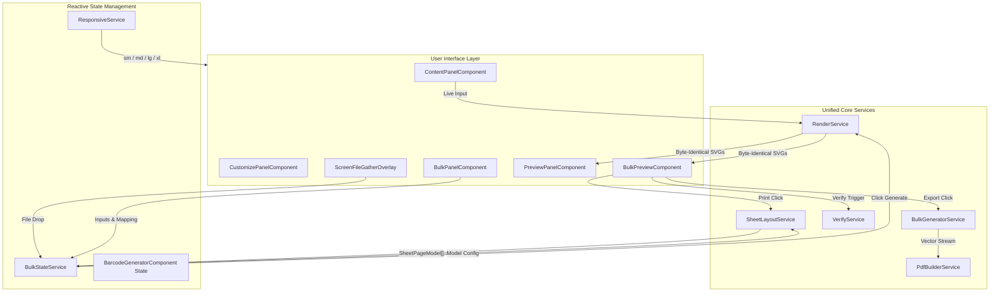

# Barcode Generator — Component Tree & Architecture

This document maps the Angular component hierarchy, signal bindings, and data flow for the Barcode Generator.

---

## 1. ASCII Component Hierarchy

```
AppComponent (apps/tool-barcode-generator/src/app/app.component.ts)
└── ts-shell (packages/tool-shell)
    └── app-barcode-generator (components/barcode-generator.component.ts)
        ├── Screen File Gather Overlay (.screen-file-gather-overlay) [Window-level Drag & Drop]
        │
        ├── Left Workspace Card (Configuration Controls)
        │   ├── Tab Strip Navigation (Content | Customize | Bulk | [Preview on sm])
        │   │
        │   ├── app-barcode-content-panel (components/content-panel/) [Single Mode]
        │   │   ├── Barcode Name Input Field
        │   │   ├── app-barcode-format-select (components/format-select/) [Searchable Dropdown]
        │   │   ├── Value Input with Clear Button
        │   │   ├── Live Character Counter (Fixed length formats)
        │   │   ├── Auto-detect Suggestion Chip
        │   │   ├── QR Recommendation Chip ("Make QR")
        │   │   └── Format-Specific Option Disclosures (Check Digit, Bearer Bars, Codabar Guards)
        │   │
        │   ├── app-barcode-customize-panel (components/customize-panel/) [Design Studio]
        │   │   ├── Size Presets (Small 80%, Standard 100%, Large 150%)
        │   │   ├── Advanced Dimensions (Width, Height, mm/inch, DPI)
        │   │   ├── Color Controls (Bar Color, Background Color, Contrast Checker)
        │   │   ├── Human-Readable Text Controls (Show/Hide, Size, Font, Bold, EAN Grouping)
        │   │   ├── Caption Designer (Text, Font Family, Font Size, Bold, Position Above/Below)
        │   │   ├── Quiet Zone Slider
        │   │   ├── Rotation Controls (0°, 90°, 180°, 270°)
        │   │   └── Reset to Defaults Action Link
        │   │
        │   └── app-barcode-bulk-panel (components/bulk-panel/) [Batch Mode]
        │       ├── Section 1: Source (List | CSV File segmented toggle)
        │       ├── Section 2: Format Picker Dropdown & Link to Customize Tab
        │       ├── Section 3: Data Input
        │       │   ├── List Textarea (Delimiter selector: Newline, Comma, Semicolon, Tab)
        │       │   ├── CSV File Dropzone with Pulse Border (.is-dragover)
        │       │   └── CSV Data Table (.review-table.csv-table)
        │       │       ├── Sticky `#` Row Counter Column
        │       │       ├── Dynamic Column Role Badges (Value, Caption)
        │       │       └── 10-Row Pagination Controls (Previous, Next, Range)
        │       ├── Section 4: Review Step
        │       │   ├── Status Summary (X valid, Y need attention, Z duplicates)
        │       │   ├── Expandable Review Table with Sizing Fit Checks
        │       │   ├── Skip Invalid Rows & Remove Duplicates Toggles
        │       │   └── Download Error Report CSV Action
        │       ├── Section 5: Output Preset Selector
        │       │   ├── Target (Print sheet PDF, Label roll PDF, ZIP of PNG, ZIP of SVG, Sheet images)
        │       │   ├── Preset Picker (Avery, Herma, Zebra, Dymo, Plain paper)
        │       │   └── Custom Layout Dimension Inputs (Cols, Rows, Width, Height, Gaps, Margins)
        │       └── Sticky Generate Button ("Generate N barcodes")
        │
        ├── Right Workspace Card (Live Preview Stage)
        │   ├── app-barcode-preview-panel (components/preview-panel/) [Single Mode]
        │   │   ├── Card Header (Barcode Name, Status Pill, History Button, Settings Button)
        │   │   ├── Paper Stage (White card, quiet zone, inline vector SVG)
        │   │   │   └── Laser Scan Line (0.65s single-shot reveal)
        │   │   └── Bottom Action Bar (Split Download PNG, SVG, PDF, Copy Image, Share Link)
        │   │
        │   └── app-barcode-bulk-preview (components/bulk-preview/) [Batch Mode]
        │       ├── Preview Header Row
        │       │   ├── Layout Spec Badge ("A4 — 3 × 7 (63.5 × 38.1 mm)")
        │       │   ├── Zoom Controls (Segmented Fit/100%/150% on lg/xl; Dropdown select on sm/md)
        │       │   ├── Caption Style Toggle Pill with Live Indicator Dot
        │       │   └── Multi-Page Navigation (< Page X of Y >)
        │       ├── Floating Caption Toast Card (.caption-toast-card)
        │       │   ├── Size Pills (Auto, 6 pt, 7 pt, 8 pt, 9 pt, 10 pt)
        │       │   ├── Color Swatches & Native Color Picker
        │       │   ├── Typography Styles (Bold, Mono, Uppercase) & Alignment (Left, Center, Right)
        │       │   └── Reset to Defaults Action
        │       ├── Generate-Gated Canvas Stage
        │       │   ├── Un-generated: Layout placeholder grid with dashed slots
        │       │   ├── Sheet View: Multi-page grid with millimetric slots
        │       │   └── Roll View: Continuous vertical strip with cut marks and scroll tracker
        │       └── Preview Action Bar
        │           ├── Status Summary ("50 labels, 2 pages" + "50 of 50 verified" badge)
        │           ├── Print Button (Isolated hidden iframe with @page styling)
        │           ├── Primary Download Button (Dynamic label shrinking on sm)
        │           └── More Menu (Alignment test sheet, manifest CSV, error report)
        │
        ├── app-barcode-history-modal (components/history-modal/) [Side Drawer Modal]
        │   └── History Item Cards (Restore, Rename, Delete, Clear All)
        │
        └── app-barcode-settings-modal (components/settings-modal/) [Dialog]
            └── Reset Preferences & Storage Controls
```

---

## 2. Signal Data Flow



---

## 3. Communication Patterns

- **Unified Render Architecture**: Both single generation and bulk generation invoke the exact same [`RenderService.render`](../../../../client/apps/tool-barcode-generator/src/services/render.service.ts) method with identical styling and options, ensuring zero discrepancy in vector geometry.
- **Centralized Reactive State (`BulkStateService`)**: Manages CSV state, column selections, validation outcomes, layout models, generate-gated preview triggers, and runtime caption styles as Angular signals.
- **Single Page Model Engine (`SheetLayoutService`)**: A single authoritative function calculates millimeter coordinates for sheet slots and roll strips. Live preview, vector PDF, canvas rasterizer, and isolated iframe print all consume this identical model.
- **Decoupled Runtime Caption Styling**: Floating toast card modifies caption layout attributes without re-running barcode generation.
- **Change Detection**: Strict `ChangeDetectionStrategy.OnPush` across all components in the tree.

---

## Related Documentation
- Technical Specification: [spec.md](../spec.md)
- Bulk Specification: [bulk-spec.md](../bulk-spec.md)
- Service Design: [service-design.md](./service-design.md)
- Styling Guide: [styling-guide.md](./styling-guide.md)
- Testing Strategy: [testing-strategy.md](./testing-strategy.md)
