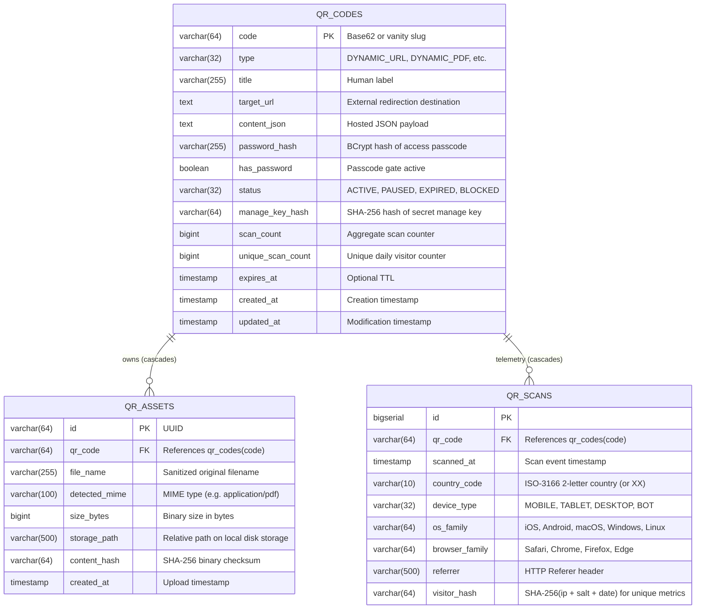

# QR Generator — Data Model & Entity Relationship Architecture

This document specifies the PostgreSQL relational schema, Flyway migrations, JPA entity models, and TypeScript frontend interfaces for the Acklet QR Generator and its Dynamic QR subsystem.

---

## 1. Entity Relationship Diagram (ERD)



---

## 2. Table Specifications & Indexes

### 2.1 `qr_codes`
* **Primary Key**: `code` (varchar 64) — Indexed for sub-millisecond `/q/{code}` lookups.
* **Indexes**:
  * `idx_qr_codes_manage_key_hash`: `manage_key_hash` (unique lookups for authorized modifications).
  * `idx_qr_codes_status`: Filters active vs paused vs expired codes.
  * `idx_qr_codes_expires_at`: Background TTL evaluation.

### 2.2 `qr_assets`
* **Primary Key**: `id` (varchar 64).
* **Foreign Key**: `qr_code REFERENCES qr_codes(code) ON DELETE CASCADE`.
* **Indexes**:
  * `idx_qr_assets_qr_code`: Fast retrieval of all files belonging to a dynamic code.
  * `idx_qr_assets_content_hash`: Duplicate file detection.

### 2.3 `qr_scans`
* **Primary Key**: `id` (bigserial).
* **Foreign Key**: `qr_code REFERENCES qr_codes(code) ON DELETE CASCADE`.
* **Indexes**:
  * `idx_qr_scans_code_time`: `(qr_code, scanned_at)` for high-speed time-series aggregation.
  * `idx_qr_scans_unique`: `(qr_code, visitor_hash, scanned_at)` for daily unique visitor calculation.

---

## 3. Privacy & Security Architecture

1. **Anonymous 256-Bit Manage Keys**:
   * Management authorization requires a 256-bit cryptographic hex key.
   * Stored in the database **only as a SHA-256 hash** (`manage_key_hash`). Even in the event of a database leak, private manage keys cannot be reversed.
2. **Passcode Protection**:
   * Creators can assign an optional PIN or password to restrict access.
   * Stored using Spring Security `BCryptPasswordEncoder`.
   * Public info endpoints omit `target_url` and `content_json` when `has_password = true` until successfully verified.
3. **No PII Persistence**:
   * Raw IP addresses are **never written to disk or database**.
   * Unique daily visitors are aggregated using a salted cryptographic one-way hash:
     $$\text{visitor\_hash} = \text{SHA-256}(\text{client\_ip} + \text{daily\_salt} + \text{date})$$
   * Do Not Track (`DNT: 1`) and Global Privacy Control (`Sec-GPC: 1`) headers are strictly honored by disabling visitor hashing entirely.
4. **Local Disk Storage Protection**:
   * Assets are stored under `<storage-dir>/<safe-slug>/<uuid>_<filename>`.
   * Path traversal sequences (`..`, `/`) are strictly rejected with `BadRequestException`.
   * Upload sizes are bounded by `max-asset-size-bytes` (20MB default).

---

## 4. Frontend TypeScript Models Reference

```typescript
// Core Content Types
export type ContentType =
  | 'url'
  | 'text'
  | 'email'
  | 'phone'
  | 'sms'
  | 'wifi'
  | 'geo'
  | 'event'
  | 'vcard'
  | 'social'
  | 'app'
  | 'crypto';

// Error Correction Levels
export type ErrorCorrectionLevel = 'L' | 'M' | 'Q' | 'H';

// Module and Corner Shapes
export type QrDotType =
  | 'square'
  | 'dots'
  | 'rounded'
  | 'extra-rounded'
  | 'classy'
  | 'classy-rounded'
  | 'diamond'
  | 'star'
  | 'heart'
  | 'cross'
  | 'scanline';

export type QrCornerSquareType =
  | 'square'
  | 'dot'
  | 'extra-rounded'
  | 'classy'
  | 'classy-rounded'
  | 'rounded'
  | 'pinch'
  | 'shield';

export type QrCornerDotType =
  | 'square'
  | 'dot'
  | 'rounded'
  | 'extra-rounded'
  | 'classy'
  | 'classy-rounded'
  | 'diamond'
  | 'star'
  | 'heart'
  | 'cross';

// Frame and Ribbon Options
export type QrFrameStyle =
  | 'none'
  | 'bottom-banner'
  | 'top-header'
  | 'polaroid'
  | 'badge-pill'
  | 'chat-bubble'
  | 'simple-border'
  | 'rounded-card'
  | 'tag'
  | 'ticket'
  | 'coffee-cup'
  | 'shopping-bag'
  | 'phone'
  | 'speech-bubble'
  | 'banner-ribbon'
  | 'badge'
  | 'minimal-bracket'
  | 'gift-box'
  | 'storefront'
  | 'sticker-peel'
  | 'delivery-box'
  | 'envelope';

export interface QrFrameOptions {
  style: QrFrameStyle;
  text: string;
  color: string;
  textColor: string;
}

// Gradient Options
export interface QrGradientOptions {
  enabled: boolean;
  type: 'linear' | 'radial';
  rotation: number; // 0 to 360 degrees
  color1: string;
  color2: string;
}

// Full Generation Options
export interface QROptions {
  content: string;
  type: ContentType;
  size?: number;
  foregroundColor?: string;
  backgroundColor?: string;
  foregroundGradient?: QrGradientOptions;
  backgroundGradient?: QrGradientOptions;
  errorCorrection?: ErrorCorrectionLevel;
  margin?: number;
  dotType?: QrDotType;
  cornerSquareType?: QrCornerSquareType;
  cornerDotType?: QrCornerDotType;
  cornerSquareColor?: string;
  cornerDotColor?: string;
  logo?: string;
  logoSize?: number;
  logoMargin?: number;
  logoBgTransparent?: boolean;
  frame?: QrFrameOptions;
}

// Scannability Verification Result
export type QrScanConfidence = 'high' | 'medium' | 'low';

export interface QRVerificationResult {
  isScannable: boolean;
  decodedPayload?: string;
  expectedPayload: string;
  match: boolean;
  message: string;
  confidence?: QrScanConfidence;
  fixAvailable?: boolean;
  reason?: string;
  tip?: string;
}

// ISO/IEC 18004 Metadata
export interface QRMetadata {
  version: number;        // 1 to 40
  capacity: number;       // character ceiling
  used: number;           // payload byte length
  usagePercent: number;   // 0.0 to 100.0%
}
```
