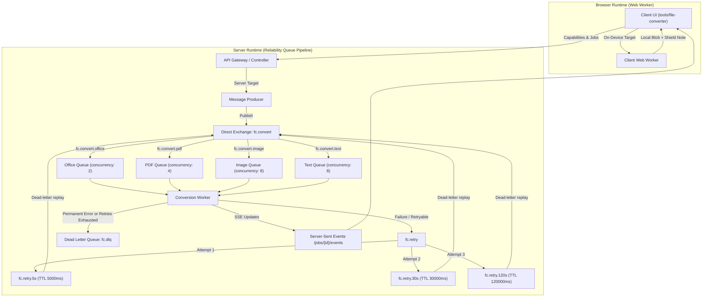

# Multi-Format File Converter Architecture & Specification

The **File Converter** module provides high-fidelity, structure-aware document transformation across structured documents, spreadsheets, presentations, plain text, and visual outputs for the Acklet platform.

Related Documentation:
* [Standalone Tool Architecture](standalone-tool-architecture.md)
* [UI Design System](ui-design-system.md)
* [Verification Guide](verification-guide.md)
* [Third-Party Notices](../THIRD-PARTY-NOTICES.md)

---

## 1. System Architecture

### Architectural Principles
* **Two Runtimes, One Single Registry**: A centralized registry governs all capabilities. Conversions run either directly on-device in a background Web Worker (zero server uploads) or across resilient server queues with manual acknowledgments.
* **Corpus-Verified Testing Only**: A pair appears in the user interface **only** when marked `status: "tested"` backed by passing automated corpus or integration tests. Untested or planned pairs remain hidden.
* **Strict Abstraction**: No internal engine, proprietary tool, or third-party library names appear in user interfaces, client diagnostics, API error structures, or public documentation. All public licenses are cataloged in [`THIRD-PARTY-NOTICES.md`](../THIRD-PARTY-NOTICES.md).
* **Privacy by Design**: On-device conversions run entirely in the user's browser, displaying a verified "Processed on your device" note.

---

## 2. Format Support Matrix

### Stable Formats

| Input Format | Output Format | Runtime | Processing Engine | Max Size | Recommendation Score | Description |
|---|---|---|---|---|---|---|
| `DOCX` | `PDF` | Server | `office-to-pdf` | 50 MB | 99 (BEST) | High-fidelity vector PDF with font and margin preservation |
| `ODT` | `PDF` | Server | `office-to-pdf` | 50 MB | 95 | OpenDocument text to vector PDF |
| `RTF` | `PDF` | Server | `office-to-pdf` | 50 MB | 95 | Rich text document to vector PDF |
| `TXT` | `PDF` | Server | `office-to-pdf` | 50 MB | 90 | Plain text to styled document PDF |
| `HTML` | `PDF` | Server | `office-to-pdf` | 50 MB | 90 | Web markup to paginated vector PDF |
| `DOCX` | `DOC` | Server | `office-to-pdf` | 50 MB | 88 | Word document to legacy binary format |
| `DOCX` | `TXT` | Server / Browser | `office-data` | 50 MB | 86 | Clean paragraph extraction without styling |
| `DOCX` | `HTML` | Server / Browser | `office-data` | 50 MB | 89 | Semantic HTML with flowed CSS structure |
| `XLSX` | `PDF` | Server | `office-to-pdf` | 50 MB | 98 | Spreadsheet workbook to printable vector PDF |
| `ODS` | `PDF` | Server | `office-to-pdf` | 50 MB | 95 | OpenDocument spreadsheet to vector PDF |
| `CSV` | `PDF` | Server | `office-to-pdf` | 50 MB | 90 | Delimited tabular data to formatted grid PDF |
| `XLSX` | `CSV` | Server / Browser | `office-data` | 50 MB | 97 | Spreadsheet data export to comma-delimited text |
| `CSV` | `XLSX` | Server / Browser | `office-data` | 50 MB | 98 | Delimited data to structured spreadsheet workbook |
| `PPTX` | `PDF` | Server | `office-to-pdf` | 50 MB | 98 | Slide presentation deck to vector PDF |
| `ODP` | `PDF` | Server | `office-to-pdf` | 50 MB | 95 | OpenDocument presentation to vector PDF |
| `PPTX` | `PNG`, `JPG` | Server | `office-to-pdf` | 50 MB | 93 | High-resolution per-slide raster image exports |
| `PDF` | `PNG`, `JPG` | Server / Browser | `pdf-to-image` | 50 MB | 85 | High-resolution page rasterization (150/200/300 DPI) |
| `PDF` | `TXT` | Server / Browser | `pdf-to-text` | 50 MB | 80 | Clean text stream extraction from digital layers |
| `PNG`, `JPG`, `WEBP`, `BMP` | `PDF` | Server / Browser | `pdf-to-image` | 50 MB | 96 | Image files wrapped into standard page-sized PDF |
| `PNG`, `JPG`, `WEBP`, `BMP` | Inter-image | Server / Browser | `image` | 50 MB | 98 | Lossless or high-quality image format transformation |

---

### Beta Formats

Beta formats are experimental conversions with active automated corpus evaluations. In the user interface, each Beta format is badged with a dedicated **Beta** indicator featuring a tooltip explaining its scope:

| Input Format | Output Format | Runtime | Tier | Corpus Pass Rate | Tooltip / Known Limits |
|---|---|---|---|---|---|
| `DOCX` | `MD` | Browser | Beta | 100.0% | Headings, lists, bold, and tables; complex nested formatting converted to plain text. |
| `PPTX` | `TXT` | Server | Beta | 100.0% | Extracts slide titles, body bullets, and speaker notes in reading order. |
| `PDF` | `DOCX` | Browser | Beta | 100.0% | Text-focused layout; complex columns and shapes may reflow. |
| `PDF` | `XLSX` | Browser | Beta | 100.0% | Ruled or simple aligned tables only; unformatted text ignored. |

---

### What Is Not Offered (and Why)

| Requested Format Pair | Status | Reason for Omission |
|---|---|---|
| `PDF` → `PPTX` | Not offered | Presentation reconstruction requires generative layout synthesis and vector font rebuilding, which cannot currently guarantee high fidelity. |
| `IMAGE` (`PNG`/`JPG`) → `TXT` (OCR) | Planned | General unconstrained OCR without trained domain models currently yields high error rates on handwriting and low-contrast scans. Held until OCR validation reaches >= 95% corpus confidence. |
| `AUDIO` / `VIDEO` conversions | Not offered | Out of scope for document converter. Audio/video codecs require heavy transcoding pipelines handled by specialized media tooling. |
| Encrypted / Password-protected files | Rejected | Cryptographic security prohibits unauthorized conversion without user master key. System cleanly prompts user to remove password before re-upload. |
| Files exceeding 50 MB (Server) / 25 MB (Browser) | Rejected | Enforced hardware safety bounds prevent worker memory exhaustion and preserve responsiveness for concurrent platform users. |

---

## 3. Reliability & Queue Architecture

### Queue Specifications & Concurrency

1. **`fc.convert.office`**: Concurrency limit = 2. Dedicated to heavy office document rendering and layout evaluation.
2. **`fc.convert.pdf`**: Concurrency limit = 4. Dedicated to PDF rasterization and vector parsing.
3. **`fc.convert.image`**: Concurrency limit = 8. Dedicated to raster format transcoding and compression.
4. **`fc.convert.text`**: Concurrency limit = 8. Dedicated to lightweight tabular and text data transforms.

### Retry & Dead-Letter Pipeline

* **Manual Acknowledgments**: Workers invoke `basicAck` only when output storage is finalized.
* **Idempotency Guarantee**: If a worker receives a task for an item already in state `DONE` or `COMPLETED`, the task is immediately acknowledged with zero redundant execution.
* **Progressive Backoff**:
  * 1st failure (retryable) $\rightarrow$ published to `fc.retry.5s` (TTL: 5,000 ms), attempt set to 2.
  * 2nd failure $\rightarrow$ published to `fc.retry.30s` (TTL: 30,000 ms), attempt set to 3.
  * 3rd failure $\rightarrow$ published to `fc.retry.120s` (TTL: 120,000 ms), attempt set to 4.
  * 4th failure $\rightarrow$ published to `fc.dlq` (Dead Letter Queue) with status `FAILED`.
* **Backpressure Throttling**: When the office queue depth exceeds 20 pending items, new office conversion requests are throttled with HTTP 503 (`Retry-After: 30`, error code `QUEUE_UNAVAILABLE`).

---

## 4. Error Mapping & Client Recovery

Every internal error is translated to a clean, helpful message before reaching the client:

| Error Code | Error Category | User-Facing Message | UI Action |
|---|---|---|---|
| `UNSUPPORTED_PAIR` | Permanent | Conversion from this format to the chosen target is not supported. | **Change format** |
| `CORRUPTED_FILE` | Permanent | This file appears to be damaged or incomplete. Please check the file and try again. | Explain issue (no retry) |
| `ENCRYPTED` / `ENCRYPTED_FILE` | Permanent | This file is password-protected. Please remove the password and re-upload. | Explain issue (no retry) |
| `TOO_LARGE` | Permanent | This file exceeds the size limit for this format. | Explain issue (no retry) |
| `OCR_FAILED` | Permanent | Text could not be extracted from this scanned document. | Explain issue (no retry) |
| `TIMEOUT` | Retryable | Conversion took longer than the time limit. Retrying... | **Retry** |
| `ENGINE_BUSY` | Retryable | The converter is at capacity. Retrying in a few seconds... | **Retry** |
| `ENGINE_CRASHED` | Retryable | The converter encountered an unexpected issue and has restarted. Retrying... | **Retry** |
| `TEMP_IO` | Retryable | Storage write failed. Retrying... | **Retry** |
| `QUEUE_UNAVAILABLE` | Retryable | Conversion queue is temporarily unavailable. Please try again shortly. | **Retry** |
| `NO_TEXT_FOUND` | Permanent | No text found. Scanned pages need OCR. | Explain issue (no retry) |

---

## 5. UI/UX Specifications

* **Accent Presets**: Olive dual-theme palette (`#5B7A1E` in light mode, `#A3C75A` in dark mode).
* **Two-Panel Layout**: Left panel houses the file list and card states (Queued, Converting, Done, Failed); right panel houses conversion settings.
* **Queued State**: Shows a "Queued" badge. When the office queue is congested, displays "Waiting for a free converter."
* **On-Device Privacy Note**: Browser-converted files display an inline shield icon with "Processed on your device" alongside the download button.
* **Beta Badging**: Displays a compact "Beta" pill next to experimental formats with hover/focus tooltips explaining extraction constraints in plain terms.
* **Progress Percentage**: Progress bars track real-time progress via Server-Sent Events (`GET /api/file-converter/jobs/{id}/events`).
