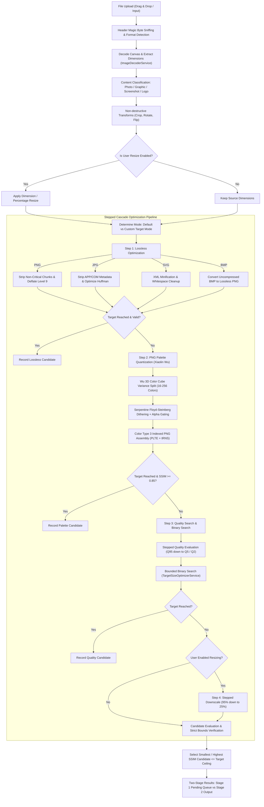

# Acklet Image Compressor — Complete Compression Architecture & Engine Guide

## 1. High-Level Overview & Mental Model

The Acklet Image Compressor is a **100% client-side, privacy-first image optimization platform**. All decoding, optimization, quantization, and encoding operations run entirely within the user's browser using Web Platform primitives (`OffscreenCanvas`, `createImageBitmap`, raw typed byte arrays) and custom algorithmic codecs. No image bytes are ever transmitted to any external server or API.

### 1.1 Core Product Principles
1. **Intelligent Dual-Mode Compression**:
   - **Default Compression Mode (No Customization)**: When a user uploads files without modifying settings, the engine automatically applies optimal compression, aiming for at least 10% (often 30%–70%) reduction while maintaining high perceptual fidelity ($SSIM \ge 0.88$).
   - **Custom Target Mode (Target KB/MB or % Reduction)**: When the user specifies an exact target size (e.g. 50 KB) or percentage, this target acts as a **strict maximum ceiling** ($\le \text{targetBytes}$). The engine will never deliver an oversized output and claim false success. If a target is physically unreachable without severe degradation, the engine warns the user and reports the closest achievable size.
2. **Strict Format Safety**:
   - The original image format is strictly preserved (PNG remains PNG, JPG remains JPG, WebP remains WebP, SVG remains SVG).
   - The engine **never** silently converts an image format to achieve a target size unless the user explicitly selected a different output format in the UI.

---

## 2. End-to-End Compression Pipeline

---

## 3. Detailed Step-by-Step Breakdown

### Step 1: Ingestion & Magic Byte Sniffing
- When a file is uploaded, the browser file object is inspected by [compressor-validation.service.ts](file:///Users/ayaz/Acklet-Temp-Tools/client/apps/tool-image-compressor/src/services/compressor-validation.service.ts).
- Rather than trusting the user's file extension, the service reads the first 16–32 bytes to sniff the file's true container format:
  - PNG: `0x89 0x50 0x4E 0x47 0x0D 0x0A 0x1A 0x0A`
  - JPEG: `0xFF 0xD8 0xFF`
  - WebP: `RIFF....WEBP`
  - BMP: `0x42 0x4D` (`BM`)
  - TIFF: `0x49 0x49` (Intel Little Endian) or `0x4D 0x4D` (Motorola Big Endian)
  - SVG: `<svg` XML text signature
- [image-decoder.service.ts](file:///Users/ayaz/Acklet-Temp-Tools/client/apps/tool-image-compressor/src/services/image-decoder.service.ts) creates an `OffscreenCanvas` or standard canvas using `createImageBitmap` or an asynchronous `Image()` element.

### Step 2: Content Analysis & Classification
In [image-optimizer.util.ts](file:///Users/ayaz/Acklet-Temp-Tools/client/apps/tool-image-compressor/src/services/image-optimizer.util.ts), `classifyImageContent` samples raw pixel data:
- **Unique Color Ratio**: Measures color diversity across sampled pixels.
- **Edge Density**: Evaluates Laplacian high-frequency edge transitions (differentiating smooth photographic gradients from sharp vector graphics and text).
- **Alpha Transparency**: Measures whether the image contains transparent or semi-transparent pixels ($\alpha < 255$).
- **Classification Output**: Categorizes the file into `photo`, `graphic`, `screenshot`, `logo-icon`, or `vector-svg`.

### Step 3: Non-Destructive Transformations
- Non-destructive operations (Crop coordinates, 90° rotations, horizontal/vertical flips) are applied to the canvas prior to compression.
- If the user explicitly configured dimension or percentage scaling, [image-resize.service.ts](file:///Users/ayaz/Acklet-Temp-Tools/client/apps/tool-image-compressor/src/services/image-resize.service.ts) resizes the canvas with bicubic resampling while preserving aspect ratio.

### Step 4: The Four-Stage Cascade Optimization Engine

#### Cascade 1: Lossless Optimization
- **Lossless PNG**: In [image-optimizer.util.ts](file:///Users/ayaz/Acklet-Temp-Tools/client/apps/tool-image-compressor/src/services/image-optimizer.util.ts), `optimizePngLossless` parses PNG chunk structures (`IHDR`, `PLTE`, `IDAT`, `IEND`). It strips ancillary text and metadata chunks (`tEXt`, `zTXt`, `iTXt`, `pHYs`, `tIME`) while retaining critical rendering chunks, recompressing IDAT with maximum Deflate level 9.
- **Lossless JPEG**: `optimizeJpegLossless` scans binary JPEG marker segments. It strips non-essential application markers (`APP1`–`APP15` containing EXIF, XMP, thumbnails) and comment markers (`COM`, `0xFFFE`) while preserving quantization tables (`DQT`), Huffman tables (`DHT`), and frame headers (`SOF0`).
- **Lossless SVG**: `minifySvgText` strips XML declarations, DOCTYPE headers, editor-specific metadata (Inkscape, Illustrator), comments, and extraneous whitespace.

#### Cascade 2: Lossy Palette Quantization (Xiaolin Wu Engine)
For PNG graphics, screenshots, and logos:
1. **Xiaolin Wu 3D Color Cube Quantization (`WuColorQuantizer`)**:
   - Builds a 3D histogram ($33 \times 33 \times 33$ bins) of RGBA color frequencies and moments.
   - Computes statistical variances along red, green, and blue axes to find optimal cutting planes, partitioning the color space into $K$ discrete palette colors ($16 \le K \le 256$).
2. **Bidirectional Serpentine Floyd-Steinberg Dithering (`ditherSerpentineFloydSteinberg`)**:
   - Errors are diffused to neighboring pixels across alternate left-to-right and right-to-left scanlines to prevent visual directional banding.
   - Transparent pixels ($\alpha < 128$) are strictly isolated so quantization error does not leak into the transparent background.
3. **Color Type 3 Assembly (`encodeIndexedPng`)**:
   - Assembles standard 8-bit indexed PNG binary bytes with `PLTE` and `tRNS` chunks.
   - Evaluates SSIM against the source image to ensure visual fidelity.

#### Cascade 3: Quality Search & Binary Search
- In lossy formats (JPEG, WebP, AVIF), the engine sweeps quality from $Q95$ down to $Q5$ (or down to $Q2$ in aggressive mode).
- In Custom Target Mode, [target-size-optimizer.service.ts](file:///Users/ayaz/Acklet-Temp-Tools/client/apps/tool-image-compressor/src/services/target-size-optimizer.service.ts) conducts a bounded binary search to locate the highest quality value where $\text{actualBlobSize} \le \text{targetBytes}$.

#### Cascade 4: Adaptive Downscaling
- Only executed if the user explicitly enabled resizing or downscaling.
- Incrementally tests scale steps ($95\%, 90\%, 85\%, \dots, 25\%$) until the byte budget is met.

### Step 5: Candidate Selection & Strict Bounds Verification
- Every generated attempt is measured directly from the produced `Blob.size` (zero mathematical estimations).
- In **Custom Target Mode**:
  - Filter candidates where $\text{size} \le \text{strictTargetBytes}$.
  - Sort candidates by highest visual quality (SSIM $\ge 0.85$, PSNR $\ge 28\text{ dB}$).
  - If multiple candidates achieve similar visual quality, select the smaller file.
  - If no candidate meets the target ceiling, report `targetUnreachable: true`, preserve the original file, and display the closest achievable size.
- In **Default Mode**:
  - Filter candidates smaller than original with $SSIM \ge 0.88$. Select the smallest visually acceptable candidate.

### Step 6: Two-Stage Output Presentation
- **Stage 1 (Pending Queue)**: Images awaiting compression.
- **Stage 2 (Compression Results)**: Displays original vs. compressed sizes, savings percentages, visual side-by-side comparison previews, and single/bulk download options.

---

## 4. Why Browser-Side Compression Was Previously "Not Accurate"

When comparing client-side browser compression with native desktop or server-side tools (like TinyPNG, Squoosh, or iLoveIMG), browser applications encounter fundamental platform constraints:

### 1. Canvas 2D `toBlob` Architectural Limitations
- The browser standard `HTMLCanvasElement.toBlob('image/png')` unconditionally outputs **32-bit RGBA PNGs**. It has no native API to output 8-bit indexed palette PNGs. Without our custom Xiaolin Wu encoder, PNGs could never achieve the 70%–90% reductions seen in tools like TinyPNG.
- The browser standard `toBlob('image/jpeg', quality)` uses the browser's built-in basic JPEG encoder. It does not use advanced algorithms such as MozJPEG Trellis quantization or multi-pass progressive scans.

### 2. Non-Linearity of Image Entropy
- Image file size does not decrease linearly with quality.
- For example, reducing quality from $Q90$ to $Q80$ on a high-frequency noisy photograph might only reduce file size by 8%, but dropping from $Q30$ to $Q20$ might cause a dramatic drop in size accompanied by severe blocking artifacts.
- Different image content behaves radically differently: flat graphics compress rapidly, while detailed textures (grass, fabric, water) strongly resist compression.

### 3. Browser Engine Discrepancies
- Chrome (Blink), Safari (WebKit), and Firefox (Gecko) implement Canvas `toBlob` differently. Safari historically clamped minimum JPEG quality, and WebP/AVIF support varies across browser engines and operating systems.

---

## 5. Improvement Roadmap: How to Achieve Elite Parity

To elevate the compression engine to the absolute highest tier of performance (matching Squoosh and native command-line utilities), the following 5 architectural enhancements represent the next evolution:

### 1. WebAssembly (WASM) Real Native Codecs
Currently, we rely on Canvas 2D encoding plus custom TypeScript quantizers. The ultimate industry standard is compiling battle-tested C/Rust codecs to WebAssembly:
- **MozJPEG WASM**:
  - Provides **Trellis quantization** (optimizes DCT coefficients specifically for Deflate entropy coding).
  - Progressive scan scripts that achieve 15%–25% smaller file sizes at the exact same perceptual quality as standard browser JPEG.
- **`libimagequant` (pngquant) WASM**:
  - Perceptual color quantization with Voronoi iteration, delivering even higher SSIM than pure Xiaolin Wu quantization for complex gradients.
- **OxiPNG WASM**:
  - Multi-threaded, exhaustive search over all 5 PNG filter types (Sub, Up, Average, Paeth) for the absolute lowest byte count.
- **libavif / SVT-AV1 WASM**:
  - Guarantees universal, high-efficiency AVIF compression across all browsers, regardless of whether the host browser supports Canvas AVIF.

### 2. Multi-Threaded Web Worker Pool (`WorkerPool`)
- Offload candidate generation, Wu quantization, and binary search loops into a pool of background Web Workers (`navigator.hardwareConcurrency`).
- This eliminates main-thread CPU spikes, keeps the UI at 60 FPS, and allows parallel batch compression of 4–8 images simultaneously.

### 3. Rate-Distortion Predictive BPP (Bits-Per-Pixel) Estimator
- Instead of starting binary searches blindly at $Q95$ and taking 5–8 iterations to converge on a target size:
  - Run a lightweight 1-millisecond spatial frequency analysis on downsampled luminance data.
  - Compute the image's Shannon entropy or DCT energy.
  - Mathematically predict the starting quality $Q_{\text{pred}}$ within $\pm 7$ quality points.
  - Cuts binary search passes from 6–8 down to 2–3 passes, accelerating target-size compression by $3\times$.

### 4. Content-Adaptive Chroma Subsampling (`4:2:0` vs `4:4:4`)
- Automatically apply `4:2:0` subsampling for photographic content (saving ~16% file size without human-visible color loss).
- Automatically force `4:4:4` subsampling for UI screenshots, diagrams, and text graphics to eliminate color-fringing and blur around high-contrast typography.

### 5. Native Lossless WebP Transcoding
- Provide lossless WebP encoding for graphics and illustrations, which consistently outperforms PNG by 26% while preserving pixel-perfect fidelity.
